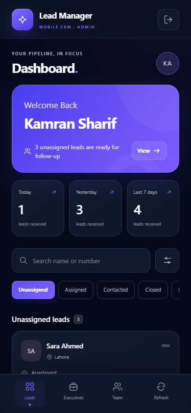
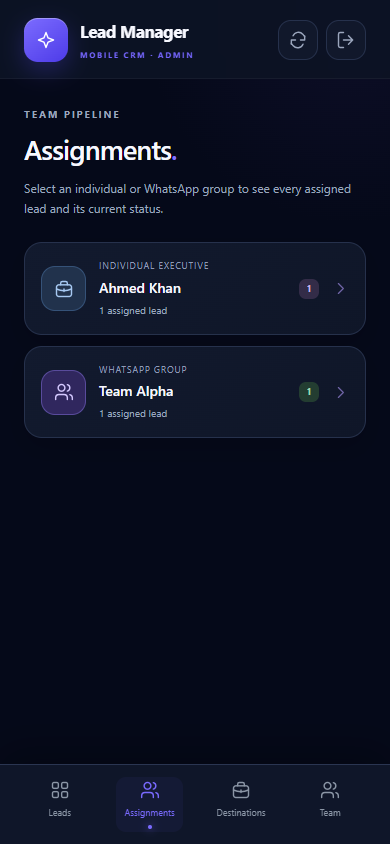
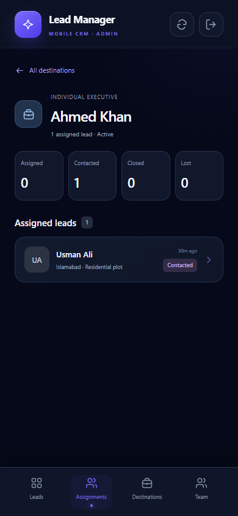
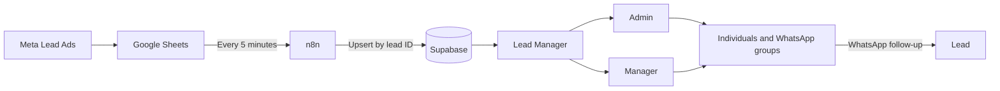

# Lead Manager

### A mobile-first CRM for Meta leads, team assignment, and sales follow-up

[](https://nextjs.org/)
[](https://supabase.com/)
[](https://tailwindcss.com/)
[](#quality-and-testing)

Lead Manager turns Meta lead submissions into an organized sales pipeline. Leads flow from Google Sheets through n8n into Supabase, where admins and managers can search, filter, assign, reassign, update, and follow up from a fast mobile interface.

<p align="center">
  
</p>

## Highlights

- **Mobile-first dashboard** with a premium dark navy and violet interface
- **Automatic lead ingestion** from Meta through Google Sheets and n8n
- **Role-based access** for administrators and managers
- **Lead assignment workflow** with safe reassignment and unassignment
- **Assignment directory** with per-agent and per-group lead lists and status totals
- **WhatsApp handoff** to individual executives or team-leader groups
- **Pipeline tracking** across Created, Assigned, Contacted, Closed, and Lost
- **Fast filtering** by status, city, search term, and Pakistan-based date ranges
- **User management** for creating, editing, and removing staff accounts
- **Destination management** for individuals, WhatsApp groups, and availability
- **Duplicate detection** based on normalized WhatsApp numbers
- **Realtime refresh** when lead records change in Supabase

## Assignment visibility

Admins and managers share the same **Assignments** workspace. It gives the team a live directory of every individual executive and WhatsApp group, including how many leads are currently assigned to each destination.

<table>
  <tr>
    <td align="center"></td>
    <td align="center"></td>
  </tr>
  <tr>
    <td align="center"><sub>Individuals and groups in one directory</sub></td>
    <td align="center"><sub>Per-destination status totals and lead details</sub></td>
  </tr>
</table>

Selecting a destination shows:

- Every lead currently assigned to that individual or group
- Totals for Assigned, Contacted, Closed, and Lost
- The current status, city, property interest, and age of each lead
- Direct access to the normal lead detail sheet for notes, status changes, reassignment, calls, and WhatsApp actions
- Active and inactive destinations, so historical assignments remain visible

The directory is read-only for managers. Admins manage destination records separately from the **Destinations** tab.

## How it works



The n8n workflow owns lead ingestion. The CRM owns assignment, status, notes, staff access, and destination management. Keeping those responsibilities separate prevents scheduled imports from overwriting sales activity.

## Access model

| Capability | Admin | Manager |
| --- | :---: | :---: |
| View and filter leads | ✓ | ✓ |
| Update status and notes | ✓ | ✓ |
| Assign, reassign, or unassign leads | ✓ | ✓ |
| View leads grouped by agent or WhatsApp group | ✓ | ✓ |
| Send lead details through WhatsApp | ✓ | ✓ |
| Manage individuals and WhatsApp groups | ✓ | — |
| Create, edit, or delete staff users | ✓ | — |

Row Level Security protects browser access to CRM data. Staff permissions are checked in PostgreSQL, while privileged Auth administration runs only through the server-side user API. The Supabase secret key must never reach the browser.

## Tech stack

| Layer | Technology |
| --- | --- |
| Application | Next.js 14, React 18 |
| Styling | Tailwind CSS and custom responsive CSS |
| Database and authentication | Supabase Auth and PostgreSQL |
| Automation | n8n scheduled workflow |
| Lead source | Meta Lead Ads through Google Sheets |
| Messaging | WhatsApp direct-chat and group deep links |
| Testing | Node test runner and PGlite |
| Hosting | Vercel-compatible |

## Local setup

### Requirements

- Node.js 18.17 or newer
- npm
- A Supabase project
- An existing `public.meta_leads` table populated by the n8n workflow

### 1. Install the application

```bash
git clone https://github.com/userkami/lead-app.git
cd lead-app
npm ci
```

### 2. Configure environment variables

Copy `.env.example` to `.env.local` and add your Supabase credentials:

```env
NEXT_PUBLIC_SUPABASE_URL=https://YOUR-PROJECT.supabase.co
NEXT_PUBLIC_SUPABASE_ANON_KEY=your-anon-or-publishable-key
SUPABASE_SECRET_KEY=your-secret-key
```

`NEXT_PUBLIC_SUPABASE_ANON_KEY` is safe for the browser and remains constrained by RLS. `SUPABASE_SECRET_KEY` is server-only: never add a `NEXT_PUBLIC_` prefix, paste it into client code, or commit `.env.local`.

### 3. Prepare Supabase

Before the first database setup:

1. Back up the database.
2. Remove `lead_status` from the n8n **Edit Fields** payload so imports preserve CRM status changes.
3. Keep the database default for `lead_status` as `CREATED`.
4. Run [`supabase/schema.sql`](supabase/schema.sql) once in the Supabase SQL Editor.

The initial script is transactional and adds the CRM fields, staff tables, functions, and RLS policies without updating existing lead rows. Do not rerun it after a successful setup.

For a database that already used the original schema, run [`supabase/user-management.sql`](supabase/user-management.sql) once instead. It adds protected staff management, last-admin protection, and safe lead reassignment. Then run [`supabase/whatsapp-groups.sql`](supabase/whatsapp-groups.sql) to add group destinations while preserving every existing executive and assignment.

### 4. Start development

```bash
npm run dev
```

Open [http://localhost:3000](http://localhost:3000) and sign in with an admin or manager account.

## n8n integration

The scheduled workflow should run every five minutes and upsert leads by the stable Meta lead `id`.

Keep these rules in place:

- Store the `sb_secret_...` credential only inside n8n's credential store.
- Do not send `lead_status`, assignment fields, or notes in the upsert payload.
- Map only source-owned Meta fields such as campaign, form, contact, city, platform, and property interest.
- Use `id` as the conflict target so a repeated import updates the same lead.

This allows n8n to refresh Meta data without resetting the work performed by the sales team.

## Lead assignment behavior

- Assignment sets the lead status to `ASSIGNED`.
- Individual destinations open a private WhatsApp chat with the lead message prefilled.
- Group destinations copy the lead message and open the selected team's WhatsApp invite link; the user pastes and sends it in the group.
- Reassignment keeps saved notes and resets the status to `ASSIGNED`.
- Unassignment keeps saved notes and resets the status to `CREATED`.
- Inactive executives remain visible on existing assignments but cannot receive new leads.
- Executives referenced by leads cannot be deleted until those leads are reassigned or unassigned.
- Concurrent assignment changes are checked to prevent one user from silently overwriting another user's newer action.

Date filters use `Asia/Karachi` boundaries and combine with status, city, and text search filters.

## Deploying to Vercel

1. Import this GitHub repository into Vercel.
2. Add all three environment variables from `.env.example` in the Vercel project settings.
3. Keep `SUPABASE_SECRET_KEY` available only to the server runtime.
4. Deploy the `main` branch.
5. Verify login, user administration, destination management, the Assignments directory, notes, and the next n8n synchronization.

Before a public production launch, update and validate framework dependencies against current security advisories.

## Quality and testing

Run the complete validation suite:

```bash
npm test
npm run build
```

The 32 automated tests cover:

- Authentication and admin-only user management
- Validation, rollback, and failure handling
- RLS enforcement for admins, managers, non-staff users, and anonymous requests
- Assignment, reassignment, unassignment, and stale-write protection
- Last-admin protection
- Executive lifecycle and foreign-key safety
- WhatsApp group link validation and group assignment
- WhatsApp number normalization

Database tests run in isolated PGlite PostgreSQL instances and do not modify the live Supabase project.

## Project structure

```text
app/
├── api/users/route.js       # Server-only staff administration API
├── AssignmentsPanel.js      # Per-destination lead and status views
├── ExecutivesPanel.js       # Sales executive management
├── UsersPanel.js            # Admin user management
├── page.js                  # Dashboard, authentication, and lead workflow
└── globals.css              # Mobile CRM design system
lib/
├── admin-users.mjs          # Authorization and Auth administration
├── executives.mjs           # Executive validation and data access
├── phone.mjs                # WhatsApp number normalization
└── supabase.js              # Browser Supabase client
supabase/
├── schema.sql               # Initial database setup
├── user-management.sql      # Staff-management upgrade
└── whatsapp-groups.sql      # Group-destination upgrade
tests/                       # API, database, permission, and helper tests
```

## Security notes

- `.env.local`, build output, local Vercel settings, and dependencies are ignored by Git.
- The publishable or anon key is intentionally used in the browser and must be protected by RLS.
- The secret key is used only by the server-side user API and the private n8n credential store.
- WhatsApp group links are visible only to authenticated staff; reset links must be updated in the CRM.
- Admin restrictions are enforced on the server and in PostgreSQL, not only hidden in the interface.
- The final admin cannot be deleted or demoted.
- Deleting a staff login preserves lead ownership, assignments, and notes.

---

Built for teams that need a focused path from new Meta lead to completed follow-up.
